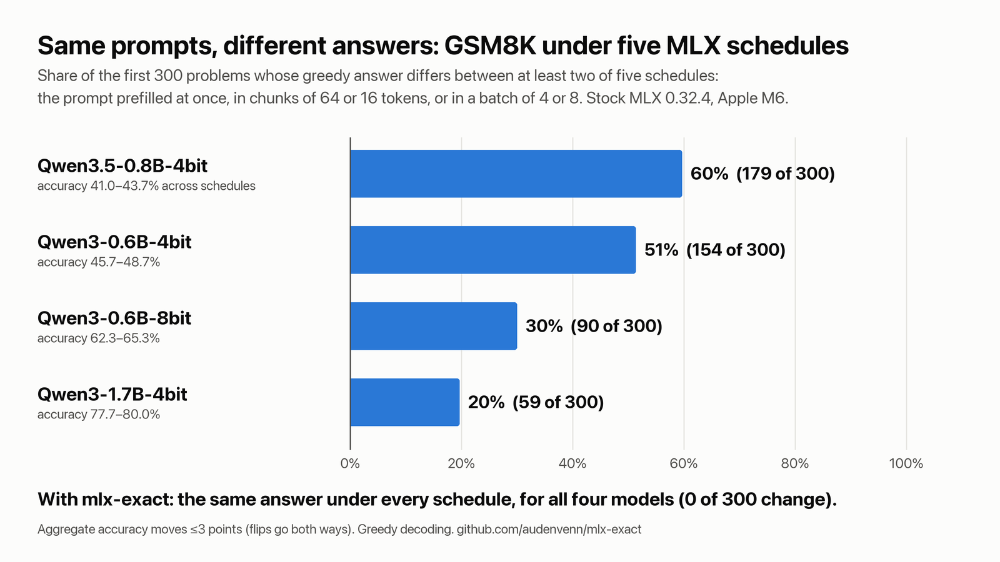

*About [mlx-exact 0.8.0](https://github.com/audenvenn/mlx-exact/releases/tag/v0.8.0) (MIT), a drop-in patch for MLX and mlx-lm on Apple silicon. Everything below was measured on an Apple M6, the only chip it is validated on, and every number comes from its README and `docs/numerics.md`.*

## Short version

In stock MLX 0.32.4 on an Apple M6, a token's logits depend on how the computation was scheduled. The prompt can be prefilled in one go or in chunks; a token can come from prefill or from decode; a request can run alone or batched with others; speculative decoding verifies drafts in groups. Each of these picks different GPU kernels, and the kernels round differently. Under greedy decoding, that is enough to change final answers. Five common ways of running the same GSM8K prompts disagree on the final answer for 20–60% of the first 300 test problems, depending on the model:



| Model | Stock accuracy across the 5 schedules | Problems where at least two schedules disagree | With mlx-exact |
|---|---|---|---|
| Qwen3-0.6B-4bit | 45.7–48.7% | 154 / 300 (51%) | same answer under every schedule |
| Qwen3-0.6B-8bit | 62.3–65.3% | 90 / 300 (30%) | same answer under every schedule |
| Qwen3-1.7B-4bit | 77.7–80.0% | 59 / 300 (20%) | same answer under every schedule |
| Qwen3.5-0.8B-4bit | 41.0–43.7% | 179 / 300 (60%) | same answer under every schedule |

The five schedules are the whole prompt prefilled at once, in chunks of 64 or of 16 tokens, and batches of 4 or of 8. Aggregate accuracy moves by at most 3 points, which is not significant, because the flips go both ways. Per problem, though, the answer depends on the schedule, and that noise lands on any paired comparison run on the same problems.

This isn't run-to-run randomness. MLX gives the same output for the same schedule every time; what changes the output is the schedule.

## Why it happens

MLX picks the kernel for a 4-bit matmul from the matrix shape:
- one row goes to `qmv`;
- small batches go to `qmv_wide`;
- medium sizes go to split-K kernels with 2–16 partitions;
- large sizes go to the GPU's matrix-accelerator kernel.

These kernels differ in two ways. Matrix-matrix kernels round each dequantized weight to bf16/fp16 before multiplying, and vector kernels don't. And each kernel sums in its own order. Attention also switches kernels with the number of queries, and its fixed key blocks mean that left padding in a batch changes the summation order too.

## Where it shows up

Measured on the same M6 with MLX 0.32.4 and mlx-lm 0.32.2:
- **Recomputation.** Greedy decoding with a KV cache diverges from recomputing the sequence at token 30 (Qwen3) or token 2 (Qwen3.5).
- **Speculative decoding.** Greedy speculative decoding (Qwen3-1.7B with a 0.6B draft) matches plain decoding on 1 of 5 prompts.
- **Batching.** A batched prompt matches the same prompt run alone on 1 of 4 prompts.
- **On-policy RL.** The sampler and the trainer compute different log-probabilities, so "on-policy" training runs slightly off-policy: 0 of 64 sampled tokens had identical log-probs, with a mean difference of about 0.05 nats per token (LoRA, Qwen3-0.6B-4bit).

With mlx-exact, all of these are identical: 5 / 5, 4 / 4 and 64 / 64.

## What mlx-exact does

It takes the arithmetic MLX already uses for long prefills as canonical, and makes every other schedule compute that same function, bit for bit:
- **Accumulation order.** The accelerator's order was reconstructed with crafted inputs and validated against the hardware.
- **Rerouting.** Every matmul that MLX would send to a different kernel goes to one that reproduces the canonical result. Where possible, that is MLX's own kernel (vendored, MIT) run with a smaller tile.
- **Attention.** Since 0.8.0, exact attention for head dims 64, 96 and 128 calls MLX's own fused attention kernel directly. Each sequence's keys are read from its first valid key, so a row of a left-padded batch sees the same keys, in the same blocks, as the sequence alone.

```python
import mlx_exact
from mlx_lm import load, generate

mlx_exact.enable()                     # before or after load()
model, tokenizer = load("mlx-community/Qwen3-1.7B-4bit")
print(generate(model, tokenizer, "Hello", max_tokens=50))
```

Install with `pip install "mlx-exact[lm] @ git+https://github.com/audenvenn/mlx-exact@v0.8.0"` (not on PyPI).

## What it costs

| | mlx-exact vs stock MLX (Apple M6) |
|---|---|
| Single-sequence decode | 0.93–0.98× across the tested models (0.95× for Qwen3-0.6B-4bit in 0.8.0) |
| Batched decode (Qwen3-0.6B-4bit, 8 sequences) | 0.89× (0.35–0.45× before 0.8.0) |
| Speculative decoding | 0.78–0.83× |
| Chunked prefill, 4-bit, chunks of 16–128 tokens | 1.4–1.8× (faster: MLX's own accelerator kernel with a 16-row tile beats the kernels stock MLX picks at those sizes) |
| Chunked prefill, unquantized bf16, chunks of 16–512 | 0.73–0.98× |
| One-shot prefill | 1.00× |

## Limits

- **Validated environment:** MLX 0.32.4 and mlx-lm 0.32.2 on an Apple M6 only. `enable()` refuses other environments unless forced, because the kernel-dispatch replica is version- and chip-specific.
- **Formats:** bf16/fp16, and 4- and 8-bit affine quantization with group size 64. fp32, and mxfp4 (the released gpt-oss checkpoints), fall back to stock MLX with a warning.
- **Architectures:** 17 mlx-lm architectures pass a tiny random-weight sweep, plus Qwen3, Qwen3.5 and Qwen3-MoE. Not exact: DeepSeek-V3-style MLA, some MoE router gates that use raw matmuls, and batched sliding-window attention.

Not claimed here: other chips or MLX versions, large MoE models end to end (only kernel timings at Qwen3-30B-A3B shapes), better accuracy (exact mode's per-matmul error is slightly higher than stock decode's, negligible next to 4-bit quantization), or speed beyond the table above. The README lists the remaining limits in full.

## Reproduce it

`experiments/gsm8k_schedule_noise.py` reruns the GSM8K comparison, stock MLX against mlx-exact, in the same run. `pytest tests/` checks the kernels, attention and end-to-end decode against prefill.

---

*Disclosure: I maintain mlx-exact. It was developed with AI assistance (Anthropic's Claude), and 0.8.0 had an independent pre-release review by another AI model (OpenAI's Codex). This post was also written with an AI assistant; every number comes from the project's README.*
